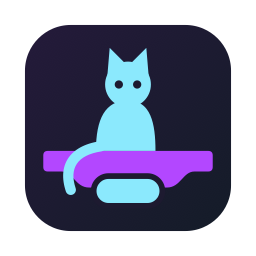
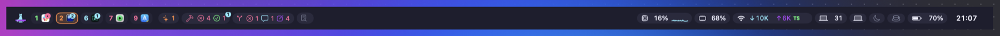
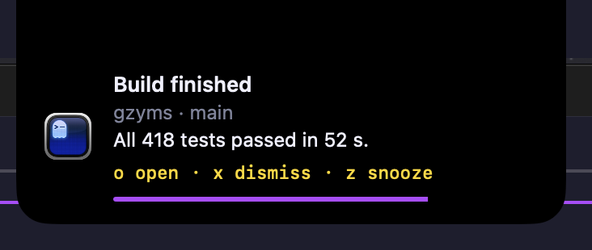

<div align="center">



# gzyms

**A status bar for macOS developers drowning in notifications.**<br>
Glance, decide, move on.

[](https://github.com/zalewskigrzegorz/gzyms/releases/latest)

[](LICENSE)
[](https://github.com/zalewskigrzegorz/homebrew-tap)

[gzyms.dev](https://gzyms.dev)



</div>

## Install

```sh
brew install zalewskigrzegorz/tap/gzyms
```

Or download the zip from [Releases](https://github.com/zalewskigrzegorz/gzyms/releases/latest) and move Gzyms to Applications.

You need:

- macOS 26 on Apple Silicon
- Accessibility, for banner keys and Dock badges
- Full Disk Access, for notifications from other apps

A wizard asks for both on first launch. This is 0.0.1, so expect rough edges.

## What it does



- [Five notification levels](https://gzyms.dev/docs/#levels), from a quiet count to a full-screen alert.
- [One banner at a time](https://gzyms.dev/docs/#stack). The rest wait in a queue.
- [Rules per app](https://gzyms.dev/docs/#rules), and a bell with a list for what you skipped.
- [Keys first](https://gzyms.dev/docs/#keyboard). Open, dismiss and snooze without the mouse.
- [One CLI](https://gzyms.dev/docs/#cli) for scripts and coding agents.
- [Plugins that are a small script](https://gzyms.dev/docs/#plugins), in any language.
- [GitHub pull requests and builds](https://gzyms.dev/docs/#github) and [your coding agents](https://gzyms.dev/docs/#agents) as pills on the bar.

No telemetry.

## Feedback

Something broken, an idea or a question? Open a [Discussion](https://github.com/zalewskigrzegorz/gzyms/discussions): Problems, Ideas or Q&A. Issues are the to-do list, so a confirmed problem or a picked idea becomes one from there.

## Contributing

Read [CONTRIBUTING.md](CONTRIBUTING.md). Before every deploy run `scripts/check.sh`. It runs a release build and all tests, and ends with `ALL GREEN`.

## License

MIT, see [LICENSE](LICENSE).

## Credits

- [NotificationNanny](https://github.com/chessper53/NotificationNanny): reading and hiding macOS notification banners, portions adapted. MIT, Copyright (c) 2026 chessper53.
- [Sparkle](https://github.com/sparkle-project/Sparkle): updates.
- [TOMLDecoder](https://github.com/dduan/TOMLDecoder): config parsing.
